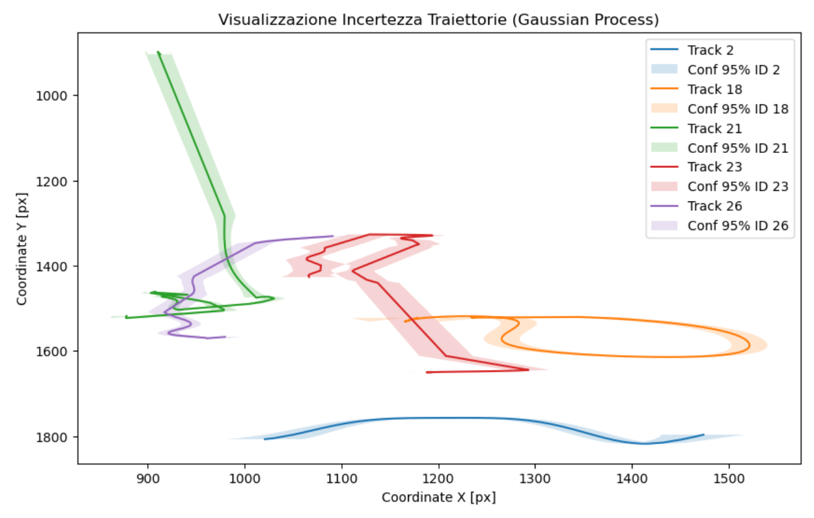
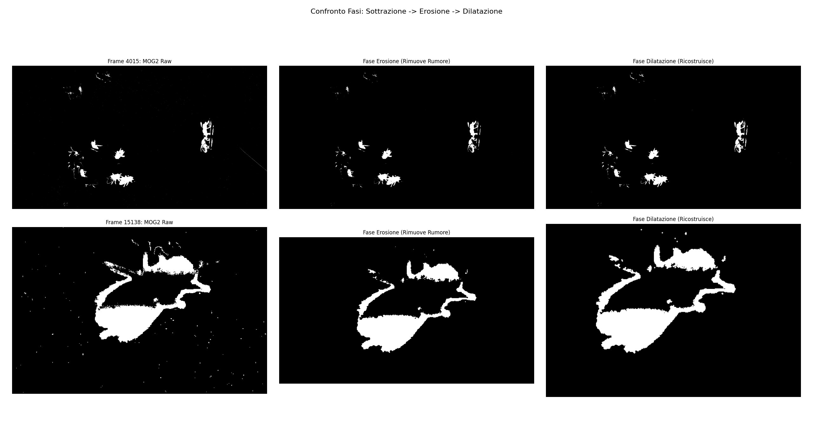
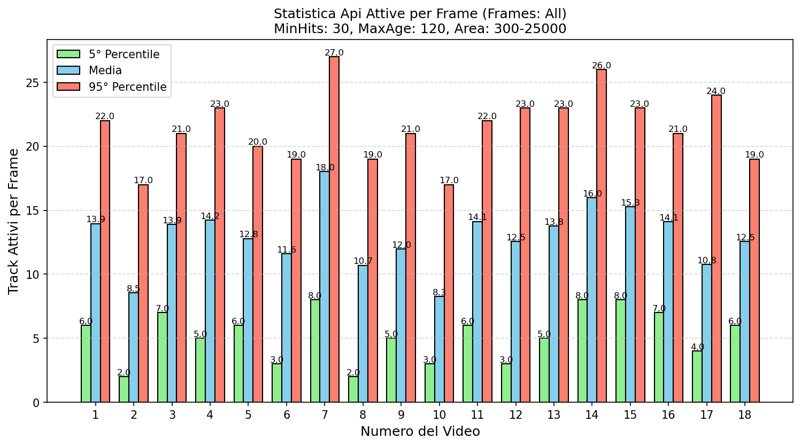
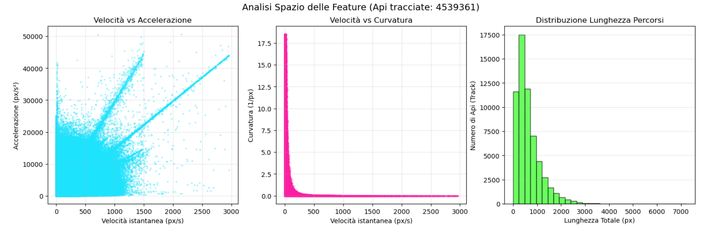
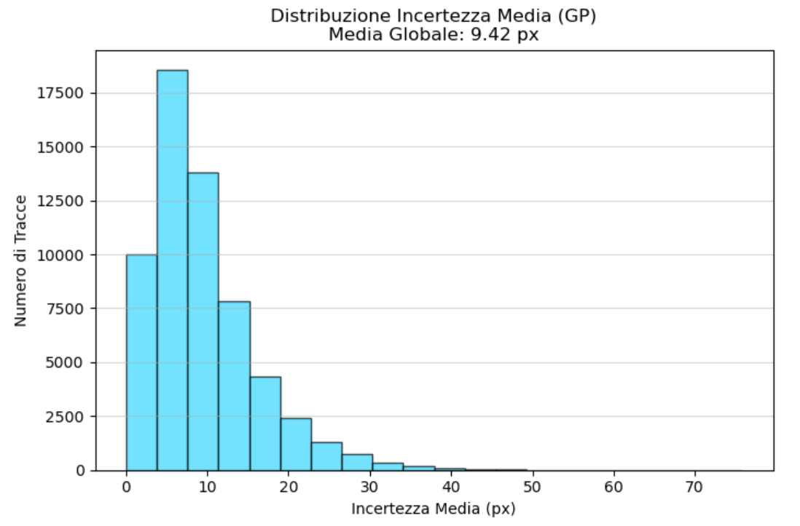

# To Bee or Not to Bee Traced 🐝
### Multi-object tracking of bees from video, with kinematic features and uncertainty quantification

University team project (February 2026). The project has two parts:
1. **A computer vision pipeline** that detects and tracks bees in 18 videos, extracts their trajectories, describes them with kinematic features and quantifies how uncertain each trajectory is.
2. **A theory presentation on sparse regularization**: sparsity priors, ℓ¹ relaxation, thresholding, ISTA and sparse deconvolution.

📓 **Notebook (in Italian):** [bees_tracking.ipynb](bees_tracking.ipynb)

📄 **Sparse regularization slides (in Italian):** [docs/sparse_regularization_slides.pdf](docs/sparse_regularization_slides.pdf)

<p align="center">
  
</p>

---

## Part 1: Bee trajectory tracking

A trajectory is a sequence of points T = {(x₁, y₁, t₁), …, (xₙ, yₙ, tₙ)}. The goal is to extract these sequences automatically from video, describe them with meaningful features, and attach a measure of reliability to each one.

### Pipeline

**1. Detection: background subtraction**
- **MOG2** (Mixture of Gaussians) separates the moving bees from the static background (`history=500`, `varThreshold=50`, shadows off).
- **Morphological opening** (erosion, then dilation) removes salt-and-pepper noise.
- Contours are filtered by area (**300 to 25,000 px**), which discards both noise and clusters of overlapping bees.

<p align="center">
  
</p>

**2. Tracking: Kalman filter and Hungarian algorithm**
- Each bee is a **Kalman filter** with a constant-velocity model. The state is [x, vₓ, y, v_y], and only the position is measured.
- In every frame, detections are matched to the predicted tracks with the **Hungarian algorithm** (`scipy.optimize.linear_sum_assignment`), with a maximum distance of 100 px.
- Track management: a track is kept only if it lasts at least **30 frames**, and is deleted after **120 frames** without detections.

**3. Feature extraction**
For every trajectory the notebook computes, with central differences (`np.gradient`):
- instantaneous speed and acceleration
- curvature, κ = |x′y″ − y′x″| / (x′² + y′²)^(3/2)
- cumulative path length

**4. Uncertainty quantification: Gaussian processes**
Each coordinate of each trajectory is fitted over time with a **Gaussian Process Regressor** (constant × RBF kernel, hyperparameters optimized with 10 restarts). Its predictive standard deviation gives a 95% confidence band around the path and a mean uncertainty for every track. Tracks longer than 500 points are downsampled to keep the fit tractable.

**5. Visual validation**
The trajectories are drawn back onto the original videos as overlays, to check the tracking by eye.

### Results

The dataset contains **18 videos** of bees in an enclosure, each 10 to 14 minutes long.

**Counting bees robustly.** Occlusions, bees that stop moving and bees that overlap make the tracker lose targets and assign new IDs. Across the dataset it created **59,780** track IDs, far more than the number of real bees, so a cumulative count would be meaningless. We counted the **active tracks per frame** instead, and summarized each video with its mean and its 5th and 95th percentiles:
- on average, **8 to 18 bees** are clearly visible and moving at any given time;
- the 95th percentile, **17 to 27 bees**, is the best estimate of how many bees are in the enclosure;
- the average detected area is stable across videos (about 3,800 to 4,500 px), a sign of a fixed camera and uniform lighting.

<p align="center">
  
</p>

**Feature space.** Speed against acceleration shows a dense core of slow movement (walking, exploring, hovering) and distinct linear bands of fast directed flight. Curvature is high only at low speed: bees turn sharply when slow and fly straight when fast. Most trajectories are shorter than 1,000 px.

<p align="center">
  
</p>

**Uncertainty.** The mean positional uncertainty from the Gaussian processes is **9.42 px**. That is small compared with the size of a bee (an area of about 4,000 px, or roughly 60 to 70 px across), so the trajectories are reliable enough for behavioural analysis.

<p align="center">
  
</p>

### Limitations and next steps
- The tracker fragments trajectories during occlusions and inside dense clusters of bees. Handling these cases, for example with appearance features or re-identification, is the main open problem.
- Detection relies on motion, so a bee that stays still for a long time fades into the background model.

## Part 2: Sparse regularization (theory)

A Beamer presentation, based on chapter 9 of *Mathematical Foundations of Data Science* (G. Peyré), covering:
- sparse approximation in an orthogonal basis and the ℓ⁰ pseudo-norm
- convex relaxation with the ℓ¹ norm
- denoising by hard and soft thresholding, and how to choose the threshold
- sparse representation in redundant dictionaries
- the ISTA algorithm (Iterative Soft Thresholding) and its iterations in closed form
- applications: sparse deconvolution and sparse wavelet deconvolution

## How to run

```bash
pip install -r requirements.txt
jupyter notebook bees_tracking.ipynb
```

The videos are **not included** in this repository because they were provided privately for the course. To run the notebook on your own footage, put the videos in a ZIP file and set `LOCAL_ZIP_PATH` in the configuration cell. Set `DEBUG_MODE = True` to process only the first frames of the first video while you tune the parameters, since the full run takes hours.

## Tech stack
Python · OpenCV · FilterPy · SciPy · scikit-learn · pandas · Matplotlib · LaTeX/Beamer

## Authors
- Antonio Carboncino
- Libera Pasqualina Ciambriello
- Alessia Coppola
- Greta Porzio

## References
- C. E. Rasmussen, C. K. I. Williams, *Gaussian Processes for Machine Learning*, MIT Press, 2006
- G. Peyré, *Mathematical Foundations of Data Science*, chapter 9
- [OpenCV documentation](https://docs.opencv.org) · [FilterPy documentation](https://filterpy.readthedocs.io/)
